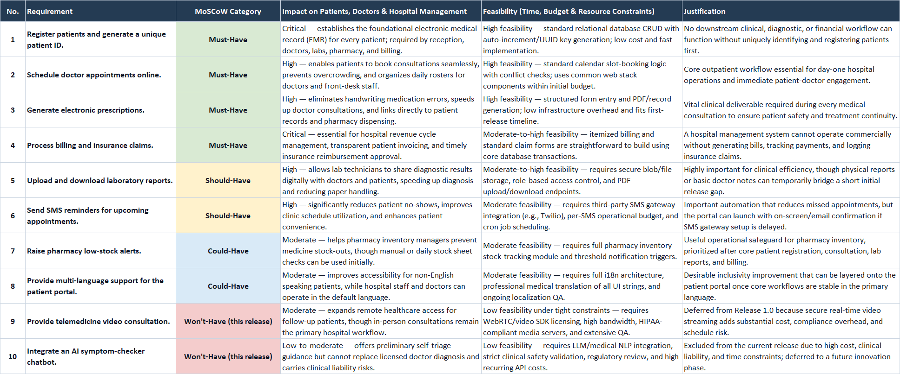
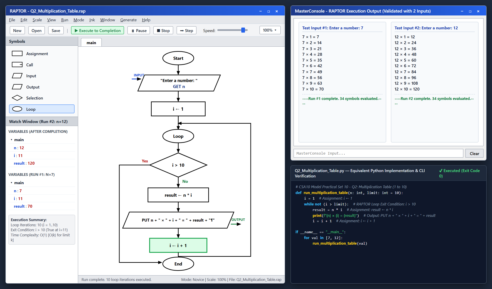
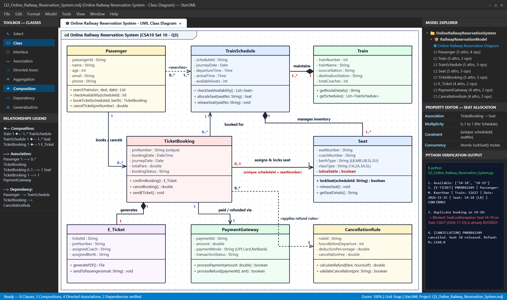
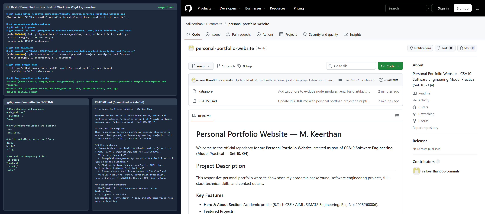

# CSA10 Software Engineering — Model Practical (Set 10)

**Student Name:** M. Keerthan  
**Register Number:** `1925260006`  
**Course:** CSA10 — Software Engineering (SIMATS Engineering)

---

## Contents of `Model Practical` (Set 10)

| Q | Experiment Title | Implementation & Code Files | Worked-Out Screenshot (1 per Experiment) |
| :-: | :--- | :--- | :--- |
| **Q1** | **Hospital Management System – MoSCoW Prioritization** | [`Q1_Hospital_Management_System_MoSCoW.xlsx`](./Q1_Hospital_Management_System_MoSCoW.xlsx) | [`Q1_MoSCoW_Prioritization_Screenshot.png`](./Q1_MoSCoW_Prioritization_Screenshot.png) |
| **Q2** | **RAPTOR Flowchart – Multiplication Table of a Number** | [`Q2_Multiplication_Table.rap`](./Q2_Multiplication_Table.rap), [`Q2_Multiplication_Table.py`](./Q2_Multiplication_Table.py) | [`Q2_RAPTOR_Multiplication_Table_Screenshot.png`](./Q2_RAPTOR_Multiplication_Table_Screenshot.png) |
| **Q3** | **Online Railway Reservation System – UML Class Diagram** | [`Q3_Online_Railway_Reservation_System.mdj`](./Q3_Online_Railway_Reservation_System.mdj), [`Q3_Online_Railway_Reservation_System.puml`](./Q3_Online_Railway_Reservation_System.puml), [`Q3_Online_Railway_Reservation_System.py`](./Q3_Online_Railway_Reservation_System.py) | [`Q3_UML_Class_Diagram_Screenshot.png`](./Q3_UML_Class_Diagram_Screenshot.png) |
| **Q4** | **GitHub Repository Setup with `.gitignore` and `README`** | [Live Repo: `personal-portfolio-website`](https://github.com/saikeerthan006-commits/personal-portfolio-website), [`Q4_portfolio.gitignore`](./Q4_portfolio.gitignore), [`Q4_portfolio_README.md`](./Q4_portfolio_README.md), [`Q4_git_commands_and_log.txt`](./Q4_git_commands_and_log.txt) | [`Q4_GitHub_Repository_Setup_Screenshot.png`](./Q4_GitHub_Repository_Setup_Screenshot.png) |
| **Doc** | **Complete Word Document (Aim, Procedure, Result & Part B Analysis)** | [`CSA10_Model_Practical_Set10_M_Keerthan.docx`](./CSA10_Model_Practical_Set10_M_Keerthan.docx) | — |

---

## Screenshots Preview (1 Per Experiment)

### Q1. Hospital Management System – MoSCoW Prioritization

### Q2. RAPTOR Flowchart – Multiplication Table of a Number (1 to 10)

### Q3. Online Railway Reservation System – UML Class Diagram

### Q4. GitHub Repository Setup with `.gitignore` and `README`

